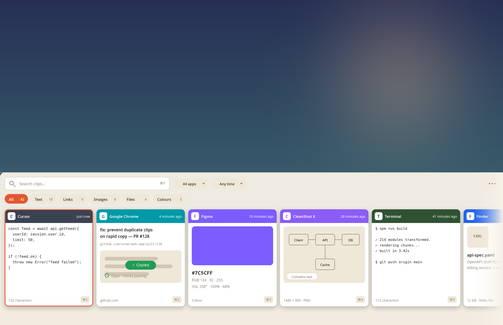
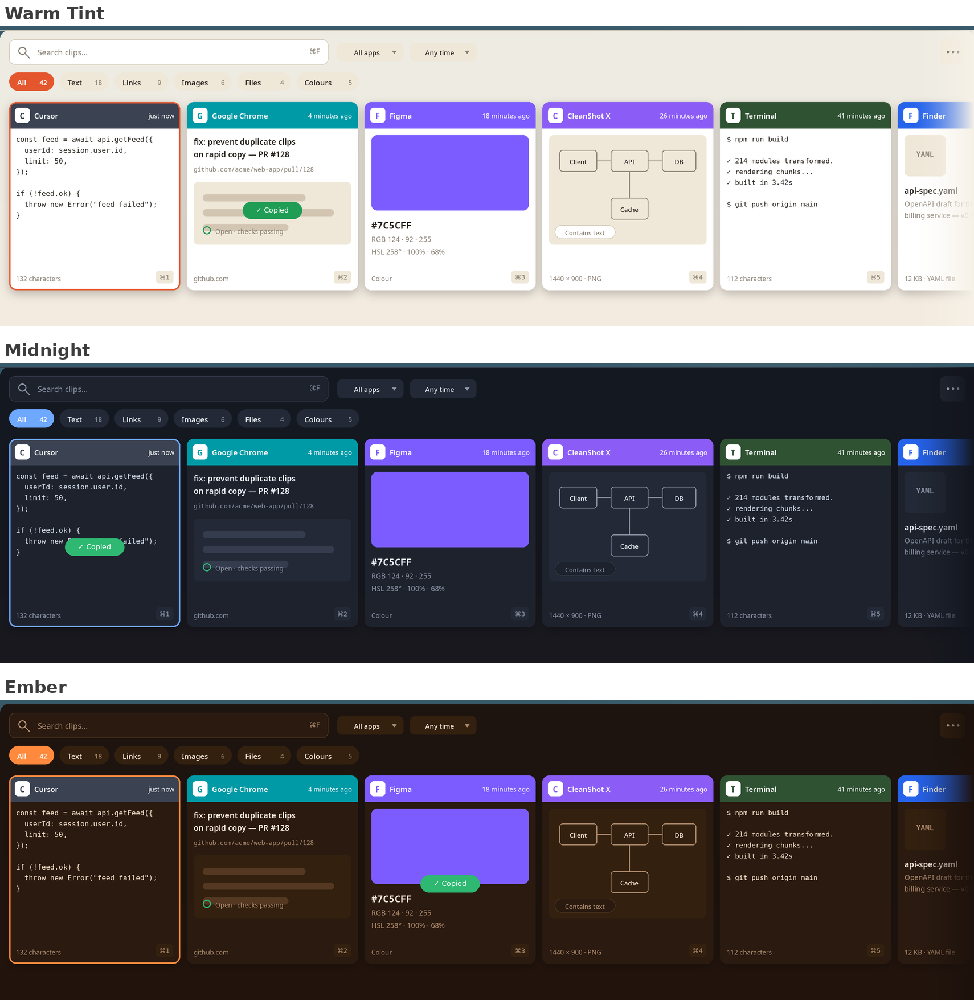

<p align="center">
  
</p>

<h1 align="center">ClipKeep for Mac</h1>

<p align="center"><strong>Everything you copy, kept — privately, on your Mac.</strong></p>

<p align="center">
  <a href="https://github.com/femisowems/clipkeep/actions/workflows/build.yml"></a>
  <a href="https://github.com/femisowems/clipkeep/releases"></a>
</p>

<p align="center">
  <a href="https://github.com/femisowems/clipkeep/releases/latest"><strong>⬇️ Download the latest release</strong></a> — macOS 11 or later, free and open source.
</p>

ClipKeep is a tiny, free, open-source macOS menu bar app that remembers
what you copy — text, images, files and colours — so the thing you copied
an hour ago is still one shortcut away. It was built as a free,
local-only alternative in the spirit of clipboard managers like Paste:
the same core job, in a single Swift file with **no dependencies, no
account, no sync, no tracking, and nothing sent anywhere**. What you
copy never leaves your Mac.

*(It keeps what you copy, for safekeeping.)*

> 🚧 **Work in progress** — ClipKeep is under active development
> (current release: **v2.16.1**). Features, behaviour and this README
> may change between versions, and things may break.

---



*The panel in the Warm Tint theme — an illustration with placeholder
clips from a developer's day (a code snippet, a pull-request link, a
design colour, a diagram, build output, a spec file). The real thing
holds whatever you copy.*



*The same panel in three of its four themes — Warm Tint, Midnight
and Ember. The fourth, Lagoon, is a deep teal.*

## Features

- **Menu bar app, no Dock icon** — the ClipKeep logo in your menu bar,
  in five styles you can switch between from the ••• menu (dimmed,
  with ⏸, while capture is paused), and a floating panel toggled by clicking it or
  pressing **⌘⇧V** from any app. The panel steps aside on its own
  when you switch to another app.

### Capture
- **Captures almost everything** — plain text, images, files copied in
  Finder, and colours, recorded in the background as you copy. Each
  clip shows **which app it came from**. Copy a colour *literal* —
  `#RRGGBB`, `rgb()`, `hsl()` — and it files as a colour clip, not
  text.
- **Link previews** — copied links fetch the page title and preview
  image in the background and render as rich cards.
- **Pause capture** any time from the panel — and the paused state
  is remembered, so quitting the app or installing an update doesn't
  silently resume capture.

### Organize and find
- **A horizontal feed of cards** — 300pt cards in a bottom-anchored,
  full-width strip, pinned clips first, the selected card outlined.
  Every card has a coloured header band per type (text cards take
  their colour from the app you copied from, links are teal, files
  blue, images purple, colour clips wear the colour itself), the
  source app's icon in a badge, relative times ("4 hours ago"), and
  Paste-style footers — character counts, image dimensions, file
  sizes.
- **Filter tabs with live counts** — All / Text / Links / Images /
  Files / Colours as pill tabs with SF Symbol icons and count badges.
  The last-used tab is remembered, Colours can sort by hue, and each
  tab has its own empty state.
- **Search that sees inside images** — image clips are run through
  on-device text recognition (Apple's Vision framework) when they're
  captured, so you can find a screenshot by the words in it. Image
  cards show a "Contains text" chip and a one-line teaser; the full
  text is in Preview, with Copy Text / Paste as Text. Search also
  covers text, file names and source apps, and filters by source app
  and recency (Today / 7 / 30 days) sit next to the search field.
  **⌘F** jumps to search; **Esc** clears it, then closes the panel.
- **Pinboards** — file keepers onto named boards (snippets, templates,
  colours). Pinned and boarded clips never expire; a board picker
  filters the list to one board at a time.
- **Preview & edit** — the eye button on a card (or right-click →
  Preview / Edit) opens any clip full-size; text clips can be edited
  and saved in place.

### Paste it back
- **Paste back, three ways**
  - Double-click any clip to copy it back to the clipboard — the
    panel closes once the copy lands. (A single click just
    selects it.) To paste
    a clip straight into the app underneath instead, use
    **⌘1–⌘9**, Enter, or the card's paste button — with
    Accessibility permission, ClipKeep presses ⌘V for you so it
    lands where your cursor is.
  - **⌘1–⌘9** quick-pastes the first nine visible clips while the
    panel is open (the cards show their numbers).
  - **Paste Stack** — queue clips with **+ Stack**, then paste them
    in order with **⌃⌥⌘V**, built for forms and repetitive entry.
- **Confirmation you can see** — copying or pasting flashes a
  "✓ Copied" chip and an accent outline on the card itself, and the
  menu-bar icon flashes green "✓ Copied" / "✓ Pasted", so actions
  with no card on screen (Preview copies, the Paste Stack) confirm
  too.
- **Right-click menu** on every card: Paste, Copy, Preview / Edit,
  Pin, Move to Board, Add to Paste Stack, Delete — colour cards add
  Copy as RGB / Copy as HSL, text cards add a **Transform** submenu
  (see Quick actions), and link cards add Copy as Markdown Link.
- **Quick actions** (v2.8.0) — the Transform submenu pastes a text
  clip transformed: as Plain Text, UPPERCASE, lowercase, Title
  Case, or Trimmed (every line trimmed, blank runs collapsed).
  Pretty-print JSON and Extract Links appear only when they apply
  to the clip. **Copy as Markdown Link** copies `[page title](url)`
  for a link clip, using its fetched preview title when present.
- **Keyboard-first navigation** (v2.9.0) — a selection (accent
  outline) rides the feed: **↑/↓** move it any time, **←/→** too
  while the search is empty, **Enter** pastes it, **Space**
  previews it, **⌫** deletes it, and typing with the search
  unfocused jumps straight into the search field.

### Yours to control
- **Private by design**
  - Copies marked *concealed* or *transient* (how password managers
    mark theirs) are **never recorded**.
  - An **Excluded apps** list: copies made while an excluded app is
    frontmost are never recorded either.
  - History lives in one local folder on your Mac. The only network
    requests the app ever makes are fetching a copied link's page
    title/preview image and checking a public version feed for
    updates — nothing about your history is sent anywhere.
- **Your history, your limit** — 200 unpinned clips by default, or
  500, 1000, or no limit. Identical copies are de-duplicated (copying
  the same thing again just brings it back to the top).
- **Four panel themes** — Warm Tint (light, frosted), Midnight,
  Ember and Lagoon (dark), switchable from the ••• menu's Theme
  submenu and remembered between launches. A **Reduce Transparency**
  toggle makes the theme tint fully opaque.
- **Settings window** (v2.7.0) — General (pause, history limit,
  panel size, clear history), Appearance (theme, menu bar icon, Reduce
  Transparency), Updates (version, status, check now) and Excluded
  Apps tabs, from the ••• menu (**⌘,**) or the menu-bar icon's right-click menu.
- **One-click updates** (v2.6.0) — when a new version is out, a slim
  strip appears under the search row (never in your feed). **Install**
  downloads it in the background with a progress bar, swaps the app
  and relaunches it; **Later** snoozes the notice to tomorrow; **✕**
  dismisses that version. Checking manually when you're current
  flashes "✓ You're up to date". Since v2.6.1 the download is
  verified against the feed's SHA-256 checksum before installing.
## Requirements

- macOS 11 (Big Sur) or later
- To build from source: the free **Xcode Command Line Tools** (for
  `swiftc`). You do **not** need the full Xcode app, an Apple Developer
  account, or the App Store.

## Building from source

```bash
git clone https://github.com/femisowems/clipkeep.git
cd clipkeep
./run-tests.sh   # optional — runs the logic tests first
./build.sh       # builds ClipKeep.app in this folder
```

Then drag `ClipKeep.app` into your Applications folder and launch
it as described below.

## Installing
**Watch the install** (1 min 42 s) — the whole first-time install, including the one-time macOS security approval:


▶ [Watch the same walkthrough as a video with narration (1:42)](https://github.com/user-attachments/assets/a2e6c924-8250-4ac5-8b7b-904a82f902b3)

1. Download the latest `ClipKeep-app-vX.Y.Z.zip` from the
   [releases page](https://github.com/femisowems/clipkeep/releases)
   and unzip it.
2. Drag **ClipKeep.app** into your Applications folder and open it.
   The app is ad-hoc signed (not notarized), so on first launch
   macOS will block it — right-click the app and choose **Open**,
   then **Open** again in the dialog. You only do this once.
3. Optional but recommended: grant **Accessibility** permission
   (System Settings → Privacy & Security → Accessibility) so
   pasting (⌘1–⌘9, Enter, the paste button) can press ⌘V for you.
   Without it, a paste still puts the clip on the clipboard for a
   manual ⌘V.

**Updating:** from v2.6.0 on, updates install themselves from the
strip described above. On an older version, use the update banner's
Download button and replace the app manually one last time.

## How to use it

| Action | What it does |
| --- | --- |
| **⌘⇧V** or click the menu-bar icon | Show / hide the panel |
| **Double-click a clip** | Copy it back to the clipboard (panel closes once the copy lands); a single click selects |
| **⌘1–⌘9** (panel open) | Quick-paste that numbered clip |
| **↑ / ↓ / ← / →** (panel open) | Move the selection (←/→ while the search is empty) |
| **Enter** (panel open) | Paste the selected clip |
| **Space** (panel open, search empty) | Preview the selected clip |
| **⌫** (panel open, search empty) | Delete the selected clip |
| **⌘,** | Open Settings |
| **⌘F** (panel open) | Focus the search field |
| **Esc** (panel open) | Clear the search, then close the panel |
| **Pin / Unpin** | Keep a clip forever, shown first in the feed |
| **Board…** | File a clip on a pinboard (or create a new one) |
| **+ Stack** | Add a clip to the Paste Stack |
| **⌃⌥⌘V** | Paste the next clip from the stack, in order |
| **✕** | Delete a clip |
| **Clear history** | Delete everything except pinned and boarded clips (asks for confirmation first) |
| **Pause capture** | Stop recording new copies until you resume |
| **Excluded apps…** | Manage the list of apps whose copies are never recorded |
| **Reset Panel Size** (••• menu) | Re-apply the fixed full-width size (the panel's size is locked) |
| **Limit popup** | History size: 200 / 500 / 1000 / no limit |

### Good to know

- The panel's size is **fixed**: full screen width × 520 tall,
  anchored above the Dock (v2.9.1). It can't be resized or moved,
  and it re-applies that frame every time it opens — full width,
  always.
- Text is stored as **plain text** — formatting is stripped at
  capture, deliberately. What you paste back is clean text.
- Deleting an image clip deletes its stored PNG too; there are no
  orphaned files.
- Quitting the app stops capture; your history is still there next
  launch.

## Mobile app — coming soon

A ClipKeep companion for phones is planned for once the Mac app is
finished. It won't be a mirror of the Mac app: iOS and Android both
forbid passive clipboard capture, so no phone app can quietly record
everything you copy the way the Mac app does. The mobile version is
designed around that limit instead:

- **Deliberate capture** — save clips on purpose: share text, links
  and images to ClipKeep from any app, with an Android Quick Settings
  tile for one-tap saving of what's on the clipboard right now.
- **Your Mac history, in your pocket** — a synced viewer for finding
  a clip on your phone and copying it back. Sync starts with a
  Google Drive folder; end-to-end encrypted sync is the longer-term
  plan. Password-manager and other sensitive clips never sync.
- **Profiles and sync** — an optional ClipKeep profile is planned
  alongside the companion: sign in on your devices and your history
  stays in step across Mac and phone, with end-to-end encrypted
  sync as the design goal. Profiles are opt-in — the Mac app stays
  fully local and account-free if you never turn sync on.
- **Android first** — built for the phone its author actually
  carries; the iPhone version follows the same deliberate-capture
  design (share sheet, Shortcuts, the system paste control).

The full feasibility research is in
[`MOBILE-RESEARCH.md`](MOBILE-RESEARCH.md).

## What it deliberately does not do

- **No iCloud sync yet.** Sync is on the roadmap; ClipKeep stays a
  single file you can read end to end. (This is the commercial apps'
  real advantage — noted honestly.)
- **No AI features.** The one exception is on-device text
  recognition for search, which runs entirely on your Mac.
- **No rich-text storage** — see above; plain text on purpose.

## How it works

ClipKeep is a single-file AppKit app (`main.swift`).
It polls the system pasteboard's change count twice a second; on a
change it skips concealed/transient copies and excluded apps, then
records the first matching type — file, image, colour, or text —
along with the frontmost app's name. Images are written as PNGs to
`~/Library/Application Support/ClipKeep/images/` and indexed in
`history.json` next to them; the Vision framework reads their text
for search. Paste-back writes the clip to the pasteboard and, with
Accessibility permission, synthesizes ⌘V. Global hotkeys use the
Carbon hot-key API, so no entitlement or helper is needed. Updates
are checked against a tiny public version feed; the one-click
installer downloads the release zip, verifies its SHA-256 against
the feed, swaps the app bundle via a detached script, and
relaunches.

## Project layout

```
clipkeep/
├── main.swift           # the whole app — capture, panel, paste-back, updates
├── tests.swift          # logic tests for the pure helpers (text, colour, store)
├── run-tests.sh         # compiles and runs the tests; CI runs it before the build
├── build.sh             # compiles ClipKeep.app with swiftc (no Xcode project)
├── SPEC.md              # the v2 spec this build implements
├── ROADMAP.md           # improvement list, inspection notes, shipped log
├── MOBILE-RESEARCH.md   # feasibility research for the future mobile version
├── AppIcon.icns         # bundled app icon (all macOS sizes)
├── AppIcon-1024.png     # icon source artwork
├── panel-warm.png       # the panel illustration (Warm Tint)
├── panel-themes.png     # the panel in Warm Tint, Midnight and Ember
├── LICENSE              # MIT
└── README.md
```

## Privacy

ClipKeep collects nothing and stores nothing beyond your clipboard
history and its own settings. There is no analytics, no account and
no tracking; the only network requests are the link-preview fetches
and the version check described above, and neither sends your
history anywhere. Your
history folder is yours: delete `~/Library/Application
Support/ClipKeep` and everything is gone.

---

Built by [Femi Sowemimo](https://github.com/femisowems) (StarterDev).

Built with encouragement from my younger sis, Fikky. Yes, your name is in the README now. You're welcome. 😄💛
